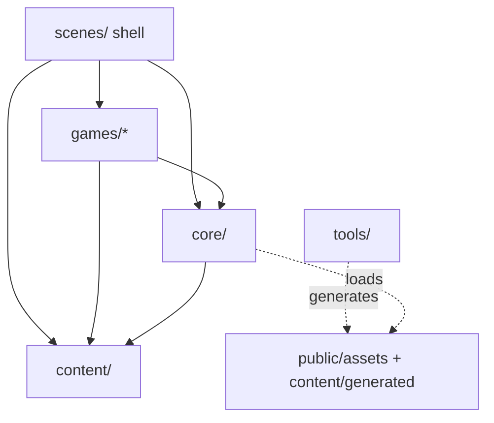
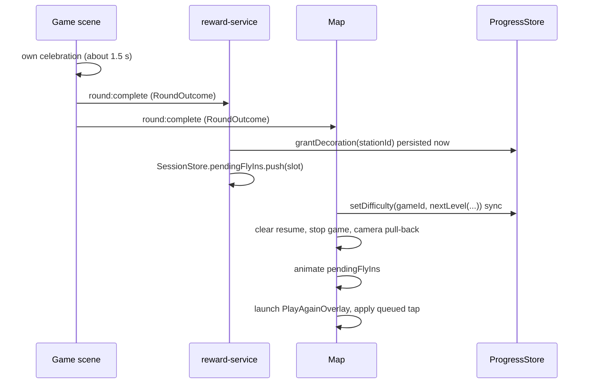
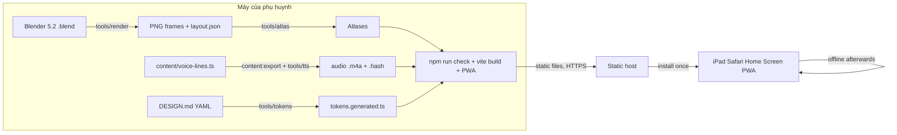
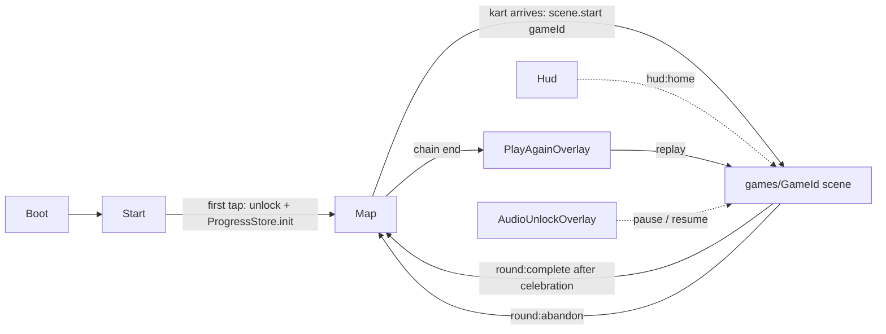

# Architecture Spine — Bé Học Chơi

> UX spines (DESIGN.md, EXPERIENCE.md — final) win over the PRD and over this spine on behaviour (island decoration replaces stickers; Shiba; low-poly; FR5 ordering; cover layout; CSS portrait rotation). Behaviour numbers (hint timings, sizes, LUFS…) live in EXPERIENCE/DESIGN and reach code only through `Tokens`.

## Design Paradigm

**Scene-per-screen game + shared core services + content-as-data.** Each screen is a Phaser `Scene`. Cross-cutting behaviour lives once in `core/` services; scenes never re-implement it. Every mini-game is a Phaser Scene implementing one `MiniGame` contract, registered in one registry. All variable content (voice lines, rounds, ladders, decorations, layouts) is data in `content/`.

| Layer | Directory | Holds |
| --- | --- | --- |
| Shell | `src/scenes/` (`Boot`, `Start`, `Map`, `Hud`, `PlayAgainOverlay`, `AudioUnlockOverlay`) | Navigation, transitions, HUD, map, reward reveal |
| Mini-games | `src/games/<GameId>/` | One Scene per game; game-specific logic only |
| Core services | `src/core/` | `progress-store`, `session-store`, `reward-service`, `difficulty`, `audio-director`, `input/` (`InputGuard`, `space`, primitives), `hint-director`, `hint-visuals`, `motion`, `tokens`, `bus` |
| Content | `src/content/` | Typed data: `voice-lines.ts`, `audio-catalog.ts`, `games/<GameId>.ts`, `decorations.ts`, `stations.ts`, `assets.ts`, `generated/<screenId>.layout.json` |
| Tools (not shipped) | `tools/` | render, atlas, tts, audio, tokens, content export, lint/validators, precache check |



Dependency rule: arrows only. `games/*` never import another game or `scenes/`; `core/` never imports `scenes/` or `games/`; `content/` imports only types. Enforced by ESLint `no-restricted-imports` per directory (AD-12).

## Invariants & Rules

### AD-1 — One MiniGame contract; the shell owns navigation, HUD and transitions

- **Binds:** FR2–FR21, EXPERIENCE "Đang chuyển cảnh", "Xong lượt", "Hỏi chơi tiếp", "Lượt dở", `button-home`
- **Prevents:** games navigating, cutting celebrations, encoding their own difficulty policy, or two games running at once
- **Rule:**
  - A `MiniGame` is a `Phaser.Scene` subclass whose scene key is its `GameId` ∈ `ice-cream | pizza | race | fishing | touch-talk | dino-puzzle | shadow-match`, registered in `games/registry.ts` with its `ladder` and `assets`. `stationId === GameId` (no separate station id type).
  - Only the shell starts it: `scene.start(gameId, { level, seed, resume? })`. At most one MiniGame scene runs at a time. `Map` starts a game only when the kart arrives (taps during the drive re-target the kart).
  - The shell owns a parallel `Hud` scene (Speaker on every screen; Home on game screens) and all transitions (kart, camera zoom in/out, reduced-motion fade via `core/motion`). Games never call `scene.start/stop/launch`.
  - A game emits **exactly one** terminal event per start, enforced by the `MiniGameBase` guard: `round:complete` with `RoundOutcome = { gameId, questions, firstTryCorrect, maxHintLevel: 0|1|2|3|4 }`, emitted **after the game's own character celebration has finished**; or `round:abandon { gameId, snapshot }` when `Hud` emits `hud:home`. After emitting, the game is inert (no input, hints off, Home ignored).
  - Difficulty: each `content/games/<GameId>.ts` exports `ladder: Level[]` (data only). One pure function `core/difficulty.ts › nextLevel(current, outcome, ladder.length)` returns the clamped next index; only `Map` calls it.
  - Map's post-round chain is one awaited sequence: `ProgressStore.setDifficulty` (synchronously on receipt) → stop game → camera pull-back → decoration fly-ins (from `pendingFlyIns`) → launch `PlayAgainOverlay`. Station taps during the chain are queued (last wins) and applied at its end; Speaker stays live. Replay reads the level from `ProgressStore`.
  - `PlayAgainOverlay` has no interactive backdrop: taps outside its two buttons fall through to Map's station hotspots, and Map closes the overlay (`overlay:close`). `AudioUnlockOverlay` calls `scene.pause()` on the active scene(s) beneath and `resume()` after the tap; no other pause mechanism.
  - `touch-talk` has no round: it never emits `round:complete`; it emits `reward:earned { gameId }` per ~8 distinct touches and leaves only via `round:abandon`.



> **Amendment 2026-10-21 (parent decision, spec-bo-do-trang-tri):** island decorations are removed at runtime. The post-round chain is settle difficulty → stop game → camera pull-back → `PlayAgainOverlay`; there is no `reward-service`, no decoration fly-in or choice step and no `pendingFlyIns`/`pendingOffers`. `touch-talk` never emits a reward event; it leaves only via `round:abandon`. `round:abandon` always takes the plain fade back. The diagram and the decoration/reward parts of the rules above are superseded.

> **Amendment 2026-10-21 (parent decision, spec-choi-lien-mach — seamless play):** the chain no longer ends in `PlayAgainOverlay` (the scene, `core/play-again*`, `content/play-again` and the replay trip are deleted). `round:complete` settles the round (difficulty saved, resume point cleared) and the game stays running; after `Timing.nextRoundDelayMs` and a `sceneFadeMs` fade it emits `round:next { gameId }`, and Map (`routeRoundNext`; ignored while a chain runs or for a game that is not running) restarts the same scene in place with fresh start data (saved level, new seed, never a resume) without releasing its assets. The chain (stop game → camera pull-back) runs only on Home (`round:leave`) and always ends with Map idle ("Mời chơi"). Navigation and start data stay owned by Map.

### AD-2 — Single owner of persisted data; single owner of decoration grants

> **Amendment 2026-10-21 (parent decision, spec-bo-do-trang-tri):** decorations are removed at runtime. `bhc.progress` is schema v3 = `{ schemaVersion, difficulty }`; the v2 → v3 migration deletes the stored `decorations` and `seq` and keeps `difficulty`. There is no `grantDecoration`/`placeDecoration`, no `DecorationSlot`, no `core/reward-service` and no `pendingFlyIns` in `SessionStore`. The decoration rules below are superseded; the rest (single storage owner, migrations, resume snapshots) still holds.

- **Binds:** difficulty memory, island decorations, "Lượt dở", touch-talk reward, any future saved state
- **Prevents:** clashing storage keys/shapes, lost rewards when Map is not running, two units choosing decorations
- **Rule:**
  - Only `ProgressStore` reads/writes persistent storage: one key `bhc.progress`, JSON `{ schemaVersion, seq, difficulty: Partial<Record<GameId, number>>, decorations: DecorationSlot[] }`. Every action writes synchronously. Each schema change bumps `schemaVersion` with a migration. `ProgressStore.init()`, called from `Start` on the first tap, is the only caller of `navigator.storage.persist()`.
  - `difficulty[gameId]` is a 0-based index into that game's `ladder`, clamped on read; missing key = 0; `touch-talk` is absent.
  - `DecorationSlot = { slotId, stationId, decorationId, seq }` (`seq` from the document's monotonic counter, no wall clock). Slots per station come from the generated layout (AD-10); "full" is per station.
  - The only public grant action is `grantDecoration(stationId) → { slot, replaced? }`: it picks the first free slot, else the lowest `seq` in that station, and the next decoration in that station's catalogue.
  - `core/reward-service` (subscribed at boot, not a scene) is the single caller: on `round:complete` and `reward:earned` it calls `grantDecoration`, pushes the result to `SessionStore.pendingFlyIns`, and for `reward:earned` replies `reward:granted { gameId, decorationId }` so `touch-talk` shows that exact item. `Map` only animates `pendingFlyIns` and never chooses.
  - `SessionStore` (memory only, lost on app close — decided) holds `resume: Partial<Record<GameId, Snapshot>>`, `pendingFlyIns`, `lastStation`. Only `Map` writes a resume snapshot (on `round:abandon`) and only `Map` clears it (on that game's `round:complete`, or when starting that game without resume).
  - `Snapshot` is JSON-only data (no object references): `{ v: 1, level, seed, questionIndex, partial }`. Questions derive deterministically from `seed`; `partial` restores progress inside the current question (placed items, slice count, trace index; `touch-talk`: current scene + distinct touched ids). Resume uses `snapshot.level`.

### AD-3 — All sound goes through AudioDirector

- **Binds:** NFR3, EXPERIENCE voice/music/SFX rules (single voice channel, ducking, ≤1 repeat/10 s, no scary sounds), `button-speaker`
- **Prevents:** overlapping speech, music not ducking, double unlock paths, games loading audio directly
- **Rule:**
  - Scenes request sound by catalog id only: `audio.say(lineId) → token`, `audio.sayChain(ids) → token`, `audio.sfx(id)`, `audio.music(id)`. No `this.sound.*`, no file paths in scenes/games.
  - `AudioDirector` wraps Phaser's built-in WebAudio unlock (reads `sound.locked`, listens for `Sound.Events.UNLOCKED`) and adds only a `visibilitychange` re-resume; if still suspended it requests `AudioUnlockOverlay`. It owns the one voice channel (queue/ignore rules from EXPERIENCE), ducking, and stops voice and music when hidden.
  - `speechEnded { token }` carries the token of the finished utterance; consumers react only to their own token.
  - Prompts are full sentences (one id). `sayChain` is allowed only for counting ("Một!… Hai!…") and name readouts, gapless on the voice channel.
  - `Hud` Speaker calls `hint.replayPrompt()` while a question is active; otherwise `audio.replayPrompt()` replays the line last registered via `audio.setPrompt(lineId)` (Map invite, overlay question).

### AD-4 — All touch goes through InputGuard

- **Binds:** NFR1, NFR2, NFR6, EXPERIENCE first-finger-wins, edge dead-zones, snap radius, hint level 4
- **Prevents:** seven games handling multi-touch, palms, dead-zones and coordinates differently
- **Rule:**
  - Games use only `core/input` primitives (`TapTarget`, `DragController`, `TracePath`, `HotspotPolygon`). Raw `pointerdown/move/up` handling and reading `event.clientX/Y` outside `core/input` are forbidden (AD-12 lint).
  - One active gameplay pointer per scene: while it is down, all other pointers are ignored for gameplay objects. `Hud` buttons accept another pointer only if it starts outside the dead-zones and no drag is in progress.
  - Dead-zones are evaluated in **screen CSS px** against the raw viewport position plus `env(safe-area-inset-*)`, inside `InputGuard` only. Content coordinates are design-space px and are converted only through `core/input/space.ts › toDesign(pointer)`, which accounts for the ENVELOP scale/crop and the portrait CSS rotation.
  - `InputGuard` exposes `setPickable(obj, bool)` and `setSnapScale(target, k)`; these are the only ways to change pickability or snap radius.
  - Page-level NFR6 guards are owned by the shell story in `index.html` (viewport `user-scalable=no, viewport-fit=cover`) and `src/styles/stage.css` (`touch-action: none`, `user-select: none`, `-webkit-touch-callout: none`, `overscroll-behavior: none`, `draggable="false"` on images, portrait 90° rotation of the stage).

### AD-5 — HintDirector owns hint timing, hint voice and hint visuals

- **Binds:** NFR4, EXPERIENCE "Gợi ý" (time OR error count, 4 levels, never downgrade, ring persists), "Chờ yêu cầu", multi-step questions
- **Prevents:** per-game hint timers, double retry voice, Speaker resetting hints, level 4 bypassing InputGuard, clocks running while paused
- **Rule:**
  - Protocol per question: `hint.beginQuestion({ promptLineId, retryLineId, step })` with `step = { correct: GameObject[], distractors: GameObject[], target: GameObject | null, action: 'drag'|'tap'|'trace', path? }`; then `hint.wrong()`, `hint.stepDone(nextStep, { promptLineId?, retryLineId? })` (same question, level kept, clock restarts; optional new lines for a multi-stage step such as the pizza oven), `hint.questionDone()` (resets level).
  - `HintDirector` plays the prompt itself and starts its clock only from the `speechEnded` of that utterance's token. It is the sole player of hint voice (level-1 retry, level-3 repeats); games never play a retry line.
  - `hint.replayPrompt()` replays the prompt, pauses the clock while speaking, and keeps the level.
  - Level 4 is applied only via `InputGuard.setPickable(distractor, false)` and `setSnapScale(target, 2)`; dimming via `hint-visuals`.
  - It emits `hint:level { gameId, level }` on Bus; games stop their ambient motion at level ≥ 2.
  - Its clock is the active scene's pausable `time` (no `setTimeout`), so `scene.pause()` and hidden-app pauses stop it. All durations come from `Tokens.Timing`.
  - Ring/hand rendering lives in `core/hint-visuals` and is reused by Map's invite schedule and the overlay re-ask; those schedules are scene-local but use `Tokens.Timing` and the scene clock.

### AD-6 — Content is data with stable ids

- **Binds:** voice lines, SFX/music, rounds, ladders, stations, decorations; EXPERIENCE voice rules (keyword pause, ~0.85× rate, homophone ban, adult approval)
- **Prevents:** hard-coded strings, stale or unapproved audio, id drift between code and assets
- **Rule:**
  - Voice lines live only in `content/voice-lines.ts` as `{ id, text, keywordPauseMs?, rate?, approved?: { textHash } }`. Id grammar `vo.<scope>.<intent>[.<subjectId>][.<n>]`, `scope` = `shell` or a `GameId`, `subjectId` a content id (e.g. `vo.shell.station-name.ice-cream`). The file path is derived from the id: `public/assets/audio/vo/<id>.m4a`.
  - One prompt = one file; combinatorial prompts are enumerated in content (a content script may generate them).
  - `npm run content:export` writes `voice-lines.json`; `tools/tts` (edge-tts) reads only that. edge-tts accepts no custom SSML (rate/pitch/volume only), so `keywordPauseMs` is realised by splitting `text` at `|` and concatenating segments with ffmpeg-generated silence; then ffmpeg two-pass `loudnorm`. The generator writes `<id>.hash` and refuses to overwrite a file whose line is approved with a matching `textHash`.
  - The check fails if a line has no file, a file has no line, a `.hash` mismatches its text, an `approved.textHash` mismatches the current text, or a line contains a banned near-homophone pair from EXPERIENCE.
  - SFX/music live in `content/audio-catalog.ts` as `{ id }` with ids `sfx.<scope>.<name>` / `music.<name>`, normalised by `tools/audio`, checked the same way.

### AD-7 — One coordinate space, cover scaling, pre-rendered art

- **Binds:** DESIGN › Layout (cover, safe area), EXPERIENCE › Responsive (CSS portrait rotation), all scenes and hit areas
- **Prevents:** art, polygons, dead-zones and HUD using different spaces or scale models
- **Rule:**
  - Design space is **1024×768 px (4:3)** at 1×; Phaser `Scale.ENVELOP` + `CENTER_BOTH` (cover; edges cropped on non-4:3 iPads).
  - `Tokens.safeRect` is the design-space rect visible on every supported iPad ratio; every interactive item and drop target in content lies inside it (validator, AD-12). `Hud` buttons are placed relative to the visible viewport plus safe-area insets, not the design origin.
  - Portrait: the stage parent is rotated 90° by CSS (no rotate screen; `RotateOverlay` does not exist). Phaser's pointer mapping is corrected only in `core/input/space.ts` (device spike in the shell story).
  - Art is pre-rendered from Blender (one fixed camera per screen); no runtime 3D. Motion = tweens plus Phaser frame animations from pre-rendered frames (AD-10).

### AD-8 — Design tokens and timings have one source

- **Binds:** DESIGN.md YAML tokens, EXPERIENCE behaviour timings
- **Prevents:** hard-coded colours, sizes and durations diverging from DESIGN/EXPERIENCE
- **Rule:**
  - `tools/tokens` generates `core/tokens.generated.ts` from DESIGN.md front matter (composite strings split into typed fields); the check fails on diff. `core/timing.ts` holds every behaviour duration named in EXPERIENCE. Both are exposed only as `Tokens.*` / `Tokens.Timing.*`.
  - Lint (ESLint flat config, `src/scenes/**` and `src/games/**`): `no-restricted-syntax` rejects string literals matching `^#[0-9a-fA-F]{3,8}$` or `^rgba?\(`; `@typescript-eslint/no-magic-numbers` with `ignore: [-1, 0, 1, 2, 0.5]`, `ignoreEnums`, `ignoreTypeIndexes`. Numbers belong in `Tokens` or `content/`.

### AD-9 — Offline-first, no runtime network, no mid-play reload

- **Binds:** NFR7, NFR8, EXPERIENCE "Đang tải", "Offline"
- **Prevents:** assets silently missing offline, a service-worker update reloading in front of the child, hidden network use
- **Rule:**
  - `vite-plugin-pwa` `generateSW` with `workbox.globPatterns: ['**/*.{js,css,html,png,webp,json,m4a,woff2,svg,ico,webmanifest}']` and explicit `maximumFileSizeToCacheInBytes: 8388608`. A build check fails unless every file under `public/assets/` is in the generated precache manifest.
  - Update policy: `registerType: 'prompt'` with no prompt UI, `skipWaiting: false`, `clientsClaim: true`. A new SW waits and applies on the next cold launch; the app never calls `updateSW()` and never reloads a running session.
  - `Boot` shows `button-play` only after `navigator.serviceWorker.ready` and precache completion (skipped in dev without SW) and `document.fonts.load` of the self-hosted font.
  - No network after install: no analytics, no CDN fonts, no remote TTS. Vite `base: './'`; manifest `start_url`/`scope` relative.

### AD-10 — Asset contract: Blender layout export, atlas naming, size caps

- **Binds:** NFR9, DESIGN components, all hit polygons, anchors and decoration slots
- **Prevents:** hand-typed coordinates at the wrong scale, texture-key collisions, oversized files dropped from precache, per-game loading schemes
- **Rule:**
  - `tools/render` (Blender via `BLENDER_BIN`) exports per screen the PNG frames and `content/generated/<screenId>.layout.json` in design-space px (1×): anchors and hit polygons from named Blender objects `anchor.<id>`, `hit.<id>`, `slot.<id>`. Content imports the generated layout; coordinates are never hand-entered. The check fails if a `stationId`/`slotId` used in content has no generated polygon/anchor.
  - `screenId` ∈ `shared | map | <GameId>`. Atlas files `public/assets/atlases/<screenId>.png|json` (Phaser JSON hash), texture key `atlas.<screenId>`, frame names `<object>/<state>/<nn>` (e.g. `shiba/happy/03`). Backgrounds are separate plates keyed `bg.<screenId>`.
  - Caps: atlas page ≤ 2048×2048; any shipped file ≤ 8 MiB (matches AD-9).
  - Loading: `Boot` loads `shared` + `map`; the shell loads a game's declared `assets` before starting it (the kart drive covers it) and releases them on shutdown. Games never call `this.load.*`.
  - Allowed motion: tweens plus Phaser frame animations from pre-rendered frame sequences.

### AD-11 — Typed Bus with scene-scoped subscriptions

- **Binds:** all cross-scene communication (AD-1, AD-2, AD-5)
- **Prevents:** payload drift, listener leaks on replay, double grants
- **Rule:** `core/bus.ts` exports a typed `EventMap` (`round:complete`, `round:abandon`, `reward:earned`, `reward:granted`, `hint:level`, `hud:home`, `overlay:close`, …); emitting or subscribing to an event outside the map is a type error. Scenes subscribe only via `bus.scoped(scene)`, which unsubscribes on `SHUTDOWN`/`DESTROY`. Only core services subscribed at boot (`reward-service`) use global subscriptions.

> **Amendment 2026-10-21 (parent decision, spec-bo-do-trang-tri):** there are no reward events: `reward:earned` and `reward:granted` are removed from `EventMap`, and `reward-service` no longer exists.

### AD-12 — One verification gate

- **Binds:** every story; AD-6, AD-7, AD-8, AD-9, AD-10 checks; the dependency rule
- **Prevents:** rules that exist only on paper, "CI fails" with no CI
- **Rule:** `npm run check` = `tsc --noEmit` + ESLint (dependency rule, AD-4 and AD-8 rules) + Vitest (`core/`, `content/`) + content validators (voice↔file↔hash, homophones, ids, polygons inside `safeRect` and outside dead-zones, target size/gap ≥ tokens, generated layout coverage) + tokens diff + precache check (after `vite build`). Every story passes it before done. CI (GitHub Actions) is optional and runs the same command.

## Consistency Conventions

| Concern | Convention |
| --- | --- |
| Naming | Files `kebab-case.ts`; classes `PascalCase`; shell scene keys = class names; game scene key = `GameId`; bus events `noun:verb` |
| Data & formats | Ids are strings from `content/`; times in ms via `Tokens.Timing`; coordinates in design-space px (1×); audio `.m4a` (AAC) mono 44.1 kHz, loudness from EXPERIENCE |
| State & mutation | Persistent → `ProgressStore` actions only; session → `SessionStore`; scene-local state stays in the scene; cross-scene talk only via typed `Bus` |
| Errors | Never show an error to the child. Missing asset → skip silently + `console.warn` (precache check makes this a dev-only path); failed first load → loading kart waits and retries |
| Text in UI | Only parent-facing station labels; strings come from `content/` |
| Testing | `npm run check` (AD-12); manual checklist on the real iPad for touch, audio, rotation, offline and SW update |

## Stack

| Name | Version |
| --- | --- |
| Phaser | 4.2.1 |
| Starter | `npx degit phaserjs/template-vite-ts app` (template 1.4.0) → bump Phaser 4.2.1 / Vite 8.3.3; merge `vite/config.dev.mjs` + `config.prod.mjs` into one `vite.config.ts` (no object `manualChunks`, no `terser`, Oxc default); delete `log.js` telemetry and use the no-log scripts |
| Vite | 8.3.3 |
| TypeScript | ~5.9.3 (typescript-eslint peer `<6.1.0`) |
| typescript-eslint | 8.71.1 |
| vite-plugin-pwa (Workbox) | 2.0.0 exact (Workbox 7.4.1) |
| Vitest | 5.0.3 |
| free-tex-packer-core (tools) | 0.3.9 |
| edge-tts (tools, Python) | 7.2.8 — voice `vi-VN-HoaiMyNeural` |
| ffmpeg (tools) | any recent; `loudnorm` two-pass |
| Blender (tools) | 5.2.2 LTS |
| Node.js | 24 LTS (`engines: ">=24 <25"`, `.nvmrc`) |
| Tool prerequisites | Python 3.12+ + `pipx install edge-tts==7.2.8`; ffmpeg on PATH (`winget install Gyan.FFmpeg`); `BLENDER_BIN` env var → Blender 5.2.2; optional `tools/doctor` verifies all three |
| Target runtime | iPadOS ≥ 16.4 Safari, Home Screen PWA, landscape [ASSUMPTION – confirm device] |

## Structural Seed

```text
play/
  assets/                 # source models: kenney/ (GLB), quaternius/ (FBX) — CC0, not shipped
  art/                    # .blend scenes, one per screen, fixed cameras, anchor./hit./slot. objects
  app/
    index.html            # NFR6 meta guards
    vite.config.ts        # single config: VitePWA, HTTPS (dev), base './'
    public/assets/        # GENERATED: atlases/, bg/, audio/vo|sfx|music, fonts/
    src/
      main.ts             # Phaser config (1024×768, Scale.ENVELOP, input.activePointers)
      styles/stage.css    # NFR6 CSS guards, portrait rotation
      core/               # progress-store, session-store, reward-service, difficulty, audio-director,
                          # input/ (guard, space, primitives), hint-director, hint-visuals, motion,
                          # tokens(.generated), timing, bus
      content/            # voice-lines, audio-catalog, stations, decorations, assets, games/<GameId>.ts,
                          # generated/<screenId>.layout.json
      scenes/             # Boot, Start, Map, Hud, PlayAgainOverlay, AudioUnlockOverlay
      games/<GameId>/     # one MiniGame scene per folder; games/registry.ts
    tools/
      render/             # Blender CLI: .blend → PNG frames + layout.json
      atlas/              # free-tex-packer-core → Phaser JSON hash
      tts/                # voice-lines.json → edge-tts + silence + loudnorm → .m4a + .hash
      audio/              # SFX/music loudnorm
      tokens/             # DESIGN.md YAML → core/tokens.generated.ts
      lint/               # content validators, precache check
    README.md             # iPad cert trust steps; parent tip: Guided Access
```





**Deployment & environments:**
- `dev` envelope [ADOPTED]: **primary = PC browser on `http://localhost`** (`vite`; localhost is a secure context, so SW/offline work) with Chrome/Edge DevTools device emulation (iPad landscape 1024×768, touch emulation) and Safari-like checks where possible. **Device check = real iPad via an HTTPS preview deploy** at milestones (touch with real fingers, multi-touch/palm, Safari audio unlock & silent switch, Home-Screen install, offline, portrait rotation) — no certificate install on the iPad. No LAN HTTPS (mkcert) setup.
- `prod` = static host over HTTPS [ASSUMPTION: GitHub Pages or Cloudflare Pages], deployed by `npm run check` + `npm run build` + upload. Base-path note: GitHub Pages serves under `/<repo>/`, Cloudflare Pages at root; `base: './'` + relative manifest `start_url`/`scope` keeps both working, SW scope = deploy directory.
- No server, no backend, no secrets.

## Capability → Architecture Map

| Capability / Area | Lives in | Governed by |
| --- | --- | --- |
| FR1 start + audio unlock | `scenes/Start`, `core/audio-director` | AD-3 |
| FR2–3 map, stations, Home/Speaker | `scenes/Map`, `scenes/Hud`, `content/stations` | AD-1, AD-4, AD-7, AD-10 |
| FR4–6 Tiệm kem | `games/ice-cream` | AD-1, AD-4, AD-5 |
| FR7–9 Làm pizza | `games/pizza` | AD-1, AD-4, AD-5 |
| FR10–12 Đường đua | `games/race` (`TracePath`) | AD-1, AD-4, AD-5 |
| FR13–14 Câu cá | `games/fishing` | AD-1, AD-4, AD-5 |
| FR15–17 Chạm là nói | `games/touch-talk` | AD-1, AD-2 (`reward:earned`), AD-3 |
| FR18–19 Ghép khủng long | `games/dino-puzzle` | AD-1, AD-4, AD-5 |
| FR20–21 Tìm bóng | `games/shadow-match` | AD-1, AD-4, AD-5 |
| Island decoration (replaces FR22–23) | `core/reward-service`, `core/progress-store`, `scenes/Map`, `content/decorations` | AD-2, AD-10 |
| Difficulty memory | `core/difficulty`, `core/progress-store`, `content/games/*` | AD-1, AD-2 |
| Lượt dở (resume) | `core/session-store`, `scenes/Map` | AD-1, AD-2 |
| NFR1–2 touch | `core/input` | AD-4 |
| NFR6 page guards | `index.html`, `src/styles/stage.css` | AD-4 |
| NFR3 voice-first | `core/audio-director`, `content/voice-lines`, `tools/tts` | AD-3, AD-6 |
| NFR4 hints | `core/hint-director`, `core/hint-visuals` | AD-5 |
| Reduced motion | `core/motion` | AD-1, AD-5 |
| NFR7–8 offline, safe | PWA config, precache check | AD-9, AD-12 |
| NFR9 visuals | `art/`, `tools/render`, `tools/atlas`, `core/tokens` | AD-7, AD-8, AD-10 |

## Deferred

- **Per-game ladders and round content** — data in `content/games/*`, authored per story behind AD-1.
- **Difficulty thresholds inside `nextLevel`** — [ADOPTED] +1 when `firstTryCorrect === questions`, −1 when `maxHintLevel === 4`, else 0; tune with the child.
- **Decoration catalogue and slot count per station** — open in EXPERIENCE; slots are `slot.<id>` objects in Blender (AD-10).
- **Exact tween/animation choreography** — per scene, owned by EXPERIENCE + code.
- **State library** — none; plain TypeScript classes.
- **Portrait rotation pointer mapping** — decided (CSS rotation, AD-7); device spike in the shell story confirms `space.ts` mapping.
- **Silent-switch behaviour** (`navigator.audioSession.type = 'playback'`) — test on the real iPad before relying on it.
- **Palm filtering by touch radius** — only if `Touch.radiusX/Y` is measurable on the device (EXPERIENCE).
- **TTS provider fallback** — edge-tts is unofficial; regenerate the same catalog with Azure or Google Cloud vi-VN voices if it breaks.
- **SFX/music sourcing** — CC0 sources, licence list in README.
- **Accessibility settings, analytics, accounts, i18n, app-store packaging** — out of scope per PRD.
